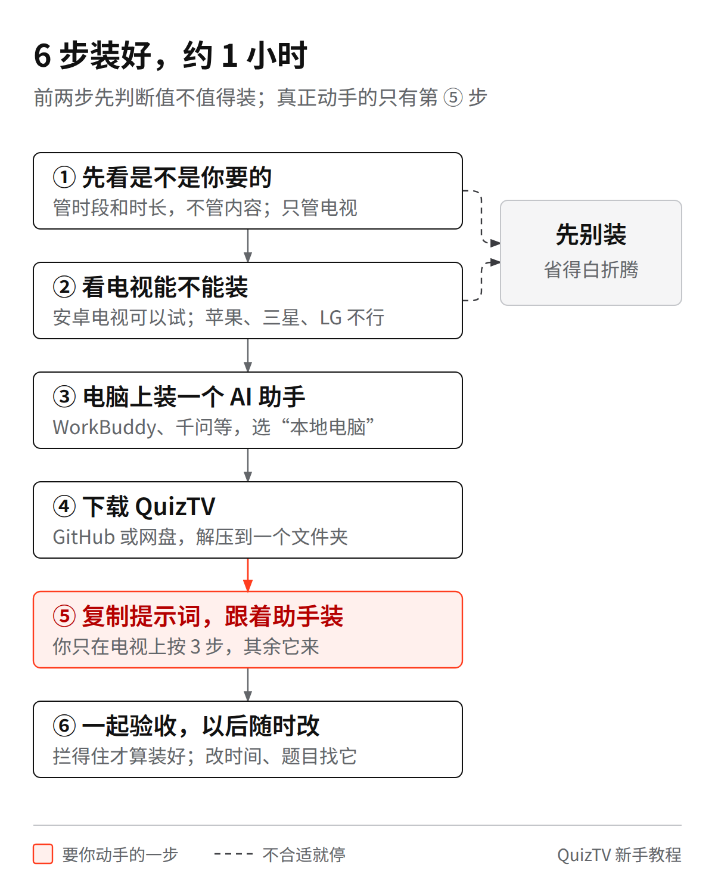
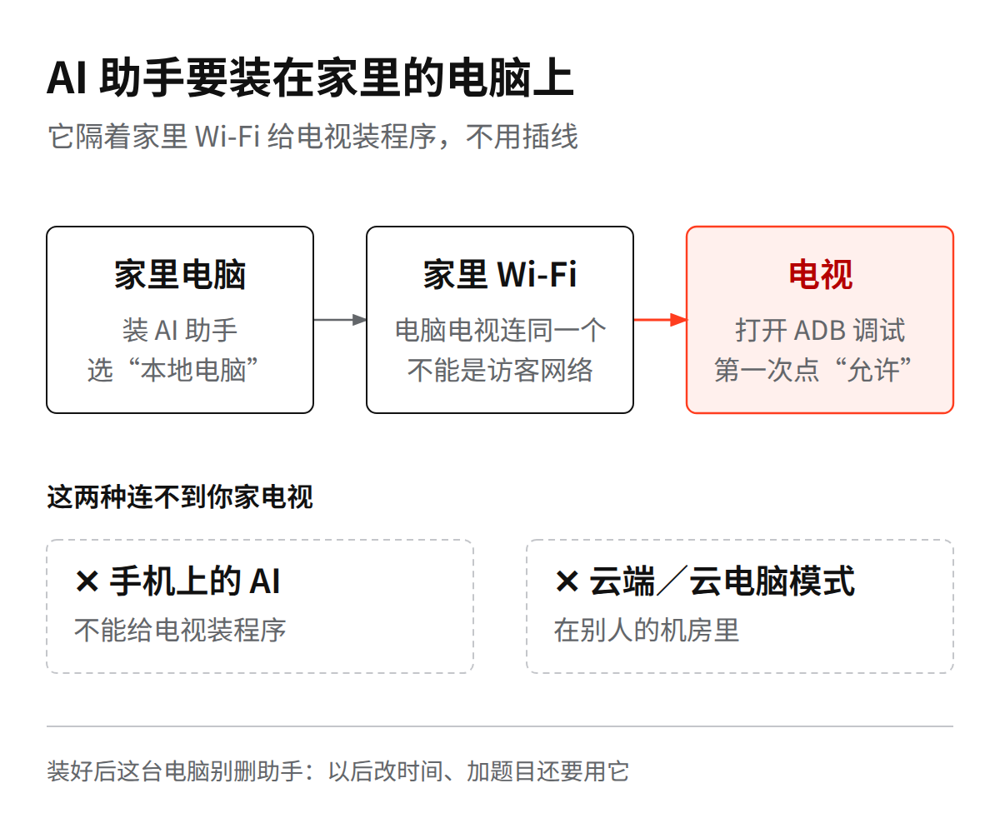
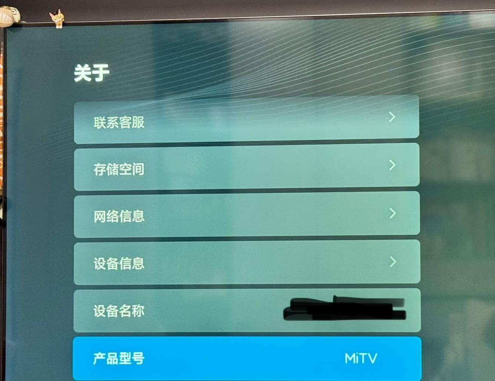
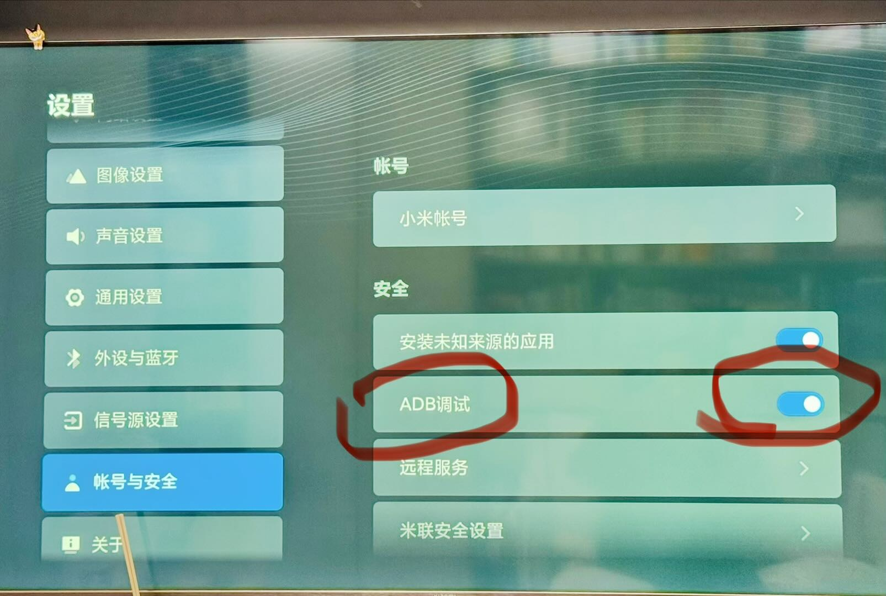

# 孩子先答题再看电视 - QuizTV新手教程

本软件免费、开源，完全不懂电脑也没关系，找个会干活的 AI 助手带你装就行。

第一次装大概要 1 小时。其实大部分活儿 AI 会做，你自己只要拿着遥控器按几下。

---

## 第 1 步：先看功能是不是你要的

**它能做的**

- 到看电视的时间，一开机先出题，答对了才能看
- 每次看多久、一天最多看多久、分几趟看（比如周末上午、下午、晚上各 30 分钟），你说了算
- 快到时间会提前提醒；到点会先提示孩子，然后锁屏
- 家长输入密码，能直接跳转随便看模式
- 题库内置，可以通过 AI 助手自行换成你家孩子平时的错题

**它不能做的**

- 只能管装了这个软件的电视（或者电视盒子），管不了手机和平板
- 只管看多久，不管看什么：分不出孩子是在看动画片还是纪录片
- 题目全是文字，孩子得能自己读题（一般适合一年级以上）
- 自带的题只有上海二年级的数学和英语，其他年级或者科目，可以让 AI 助手另外制作

**你需要准备**

- 一台家里用的电脑（Windows 10 以上，或者 macOS 12 以上），
- 大约 1 小时空闲时间，最好挑孩子不在家的时候弄

如果都合适，再往下看。

---

## 第 2 步：看电视能不能装

拿遥控器按“主页”键回到电视首页，打开“设置”（小米电视在首页右上角的小齿轮，或者按遥控器上的“菜单”键），找到“关于”（有的电视叫“关于本机”或者“设备信息”）。拿手机把这一页拍下来，等会儿发给 AI 助手看。

|  | 电视类型 | 说明 |
|---|---|---|
| ✅ 完整测过 | 小米 MiTV-MFTP0 | 作者家里这台，每个功能都测过 |
| 🟡 可以试 | 小米、红米、海信、TCL、长虹、创维、索尼、飞利浦等**安卓系统**的电视；小米盒子、当贝盒子等安卓盒子；极米、坚果等安卓投影 | 不保证一定能成，但装上试一下就知道 |
| ❌ 别试了 | 苹果电视、三星、LG；电信、移动、联通送的 IPTV 机顶盒；没法连网的老电视 | 系统不是安卓，或者被锁死了 |
| ⚠️ 不建议 | 华为、荣耀智慧屏 | 还没人试过，调试功能很难打开 |

要是孩子平时是用电视盒子看，那就装在盒子上。

---

## 第 3 步：电脑上装一个 AI 助手

要选**能动手操作电脑**的 AI 助手装在电脑上（手机版不行）。要是你平时买了会员，直接用手头的就行。

| 助手 | 免费额度 | 下载 |
|---|---|---|
| **WorkBuddy**（腾讯，推荐） | 体验版每月送 500 积分 | workbuddy.cn |
| **千问**（阿里） | 工作助理每天有免费次数 | qianwen.com/download |
| 豆包工作（字节） | 以官网为准 | doubao.com/work |
| Kimi Work | 要开会员 | kimi.com |

照着官方指引装就行，比如 WorkBuddy：workbuddy.cn/docs/workbuddy/From-Beginner-to-Expert-Guide/Installation-Win-Guide （苹果 Mac 电脑把链接末尾的 Win 换成 Mac）。

装好之后第一次打开：

- 用微信、QQ 或者手机号登录。
- 弹窗“是否允许操作本地电脑”，点允许。苹果电脑弹出“想要访问桌面／文稿文件夹”，也点允许。
- 用豆包工作的，记得多走一步：打开 **设置 → 隐私与安全 → 本地设备权限**，把“访问文件系统”和“运行本地应用”都打开。

**这里最容易踩坑：记得选“本地电脑”模式。** AI 助手一般有“云端／云电脑”和“本地电脑”两种，云端等于连着别人机房里的电脑，根本连不上你家客厅的电视。

---

## 第 4 步：下载 QuizTV

下载链接，随便选一个下就行 （Github 作者会随缘更新功能）：

- **GitHub**：github.com/Madkyotiger/QuizTV ，点绿色的 Code 按钮，再点 Download ZIP
- **百度网盘**（打不开上面那个就用网盘，里面自带了安装包）：pan.baidu.com/s/1BVK4XAbO2gXNUxImb12rpg 提取码：9kht。要先登录百度账号；网页提示装客户端的话，跟着装一下就行。

一个压缩包，一般默认在电脑的“下载”文件夹里，**先解压**（Windows 电脑：点右键 → 全部解压缩；苹果电脑：直接双击），把「QuizTV」文件夹拖到桌面上。别直接在压缩包里用，不然助手找不到文件。

---

## 第 5 步：复制提示词，跟着助手装

**动手之前，先去电视上弄好三件事**

1. **电视连上家里的 Wi-Fi**，必须跟电脑连同一个（不能连访客网络）。
2. **打开 ADB 调试。** 这是电视留给电脑连接用的开关，平时藏起来了，得先把它“解锁”出来：

   - 小米、红米电视：打开 **设置 → 关于**，用遥控器光标移到“**产品型号**”这一行，**对着按“确定”键 7 次以上**，直到屏幕上提示进入开发者模式。
   - 退回设置，点进 **账号与安全**，这时里面才会多出一行“**ADB 调试**”，把它改成“**允许**”。
   - 别的牌子电视：一般是在“关于”里对着“版本号”连按 7 次，再去“开发者选项”里打开“USB 调试”或者“网络调试”。要是找不到，把设置页面拍张照发给助手问。
3. **记下电视的 IP 地址。** 也就是电视在家里 Wi-Fi 里的门牌号。小米电视：设置 → 网络（或者“网络与连接”）→ 点开连着的 Wi-Fi，看“IP 地址”，长得像 192.168.1.20 。

**顺便想好这几件事，等下助手会问你**

- 你想设的 4 位数家长密码
- 答题界面上怎么叫孩子的小名
- 每周哪几天、几点到几点看电视前要答题；一次看多久；一轮答几道题

**接下来打开 AI 助手**

1. 点新建任务，模式选“本地电脑”，文件夹选桌面上刚才放好的「QuizTV」文件夹。
2. 把下面这段话整段复制进去，横线的地方改成你自己家的：

> 我想在家里电视上装 QuizTV（孩子先答题才能看电视），文件已经解压在当前文件夹。请先完整读一遍文件夹里的 AGENTS.md，照里面“第一次装到电视”一节，一步一步带我做。我不懂电脑技术：每一步先用大白话告诉我要做什么；需要我在电视上按遥控器时，告诉我按哪里、看到什么才算对，等我回复了再继续。  
> 我的电脑是：Windows／Mac（留一个）。电视品牌型号：＿＿＿，电视 IP 地址：＿＿＿  
> 不要卸载电视上的任何程序，也不要停用电视原来的桌面。

3. 听助手的话一步步走就行。中间电视上会弹出一个提示：“是否允许调试”。拿遥控器先移到“**一律允许这台电脑**”前头的小方框，按“确定”打上勾，再去点“**允许**”（有的电视显示“确定”）。这个弹窗一会儿会自己没，没赶上点也没事，跟助手说一句“再连一次”就行。

**助手向你要电脑权限时**

- 读写文件夹：只给它桌面上「QuizTV」这一个文件夹就行。
- 运行命令：一般点“允许”。**要是看到“卸载”“停用”，或者 uninstall、disable 这些词，先点“拒绝”**，然后问它为什么要这么干。
- 下载工具时，Windows 弹出“已保护你的电脑”，或者杀毒软件拦住 adb.exe：这个是谷歌官方正规工具，放行就行。苹果 Mac 电脑提示“无法验证开发者”：去电脑的 **系统设置 → 隐私与安全性**，点“仍要打开”。
- 小米电视要是提示安装被拒绝：去电视的 **设置 → 账号与安全**，把“安装未知来源的应用”顺手打开。

---

## 第 6 步：一起验收，以后随时改

**助手会带你试这几项，全都过关才算大功告成**

- 按遥控器主页键、直接点开看剧的 App、待机后再按开机：每次都要先跳出答题页
- 一轮题做完，能正常看电视
- 关机重新开一次，电视能正常开机进系统

只要有一项不对，说明这台电视有些地方拦不住，让助手告诉你属于哪种情况。

全部装好后，电脑就能关了，电视自己会管；以后要改规矩再开电脑就行。

**装好后别忘了**

- 把家长密码和“大人看电视”怎么用教给家里老人，省得老人想看电视也被题目难住。
- 提前跟孩子讲清楚新规矩。刚开始几天，看电视的时间可以放宽一点。

**以后想改设置，直接吩咐助手**（记得先让它读一遍 AGENTS.md）

| 想改的内容 | 照着对助手说 |
|---|---|
| 改时间 | “改成周六周日上午、下午各一段，每段看 40 分钟。” |
| 换题目 | “这是孩子语文错题本的照片，照这些知识点出 10 道新题，推到电视上。” |
| 改题量 | “每轮改成数学 3 道、语文 2 道。” |
| 改称呼 | “答题页上叫孩子‘小宝’。” |
| 暂停答题 | “这周放假，先把答题关掉。” |

界面长相也能改，但要重新打包程序，比较麻烦也耗额度，新手先不折腾这个。

---

## 遇到问题

| 碰到的情况 | 怎么回事与解决办法 |
|---|---|
| 助手说连不上电视 | ① 看看是不是用了云端模式；② 电视和电脑是不是连在同一个 Wi-Fi 下；③ ADB 调试开关有没有开。要是用公司电脑开着 VPN 也会连不上，先关掉 VPN |
| 以前明明能连，今天连不上了 | 小米电视**每次关机重启都会自动关掉 ADB 调试**，去 设置 → 账号与安全 重新打开就行（这回不用再按 7 次了）。家里路由器要是重启过，电视 IP 地址可能会变，按第 5 步重新看一下新地址，报给助手 |
| 装到一半，免费额度用完了 | 别慌，电视不会坏。等第二天有额度了，跟助手说“读 AGENTS.md，接着上次的第几步做” |
| 电视系统更新后，不跳答题页了 | 让助手“按 AGENTS.md 重新把默认桌面设成 QuizTV” |
| 后面不想用了 | 家长界面输密码就能临时看。要是想彻底拆掉还原，对助手说“按 AGENTS.md 换回原来的桌面” |
| 孩子用手机投屏到电视上看 | 还没测过这种情况，可能管不住 |

---

## 以后有更新怎么办

作者会不定期加一些新功能。感兴趣的话，可以让你的 AI 助手顺手盯一下；哪天想升级了，跟助手说一句：“去 GitHub 或网盘看看 QuizTV 有没有新版本，有的话按 AGENTS.md 帮我升级。”放心，升级不会删掉你之前的设置和孩子的做题记录。

---

QuizTV 是在开源电视桌面 CleanYourTV 的基础上改的，用的是 MIT 开源协议。作者只在自己家电视上完整测过，没有专人售后，碰上问题先让你的 AI 助手照着 AGENTS.md 排查就好。
